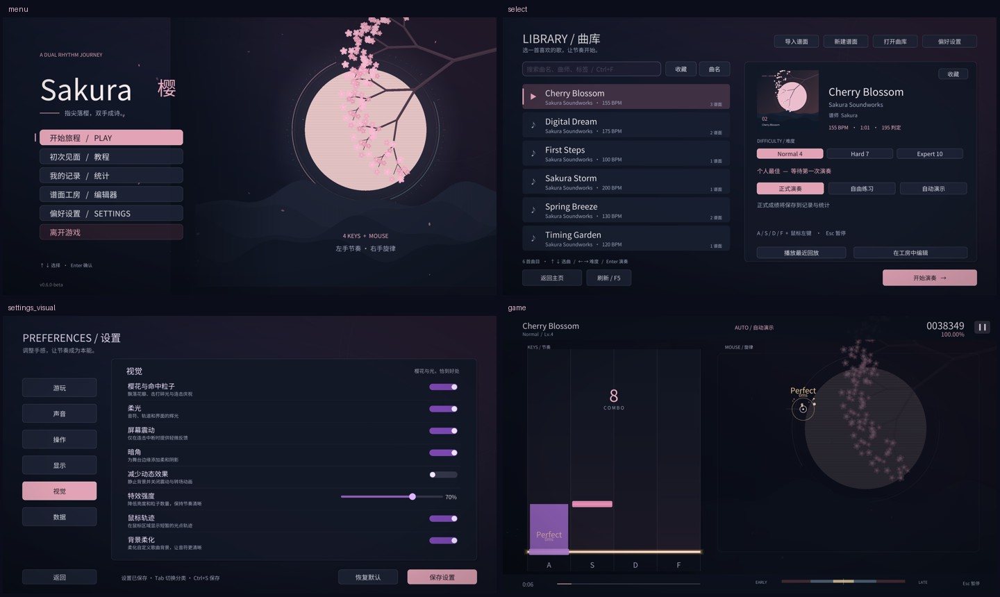

# Sakura · 樱

左手节奏，右手旋律。Sakura 是 Windows 上的双操作区音游：左侧 A / S / D / F 四轨下落，右侧鼠标点击与滑动，以夜樱、月光和花瓣为视觉主题。

当前版本：**v2.0.0** · Official 2.0 Release · Windows x64 · C++20 / SDL3 + TypeScript Hono Online Stack

[下载发行版](https://github.com/StevenLee147/Sakura/releases) · [玩家指南](doc/PLAYER_GUIDE.md) · [谱面规范](doc/CHART_FORMAT_SPEC.md) · [反馈问题](https://github.com/StevenLee147/Sakura/issues)

**Sakura-樱 v2.0.0 正式版**完整提供双域协同演奏与舞台演出（Chart Format v4）、六课交互教程、15 首纯原声 Suno OGG 精选曲库（43 张多难度谱面）、樱华道场 6 阶段位认定、UTC+8 每日挑战全球日榜、幽灵对手实时伴跑与 `SceneArena` 在线多人对战、Phira / osu! / StepMania 智能双区谱面转换器、4 套视觉皮肤与 6 套打击音包、B30 + R10 潜力值 **Sakura Rating** 与 1080p 生涯名片导出、游戏内 SHA-256 流式热更新原子自重启，以及全球排行榜、在线谱面市场（`SceneMarket`）与多端幂等云存档同步（默认接入官方在线服 `https://steven-lee.tech:233`，同时内置零配置本地双模服务端 `server/`）。详见 [路线图](doc/ROADMAP.md)。



## 开始游玩

1. 在 [Releases](https://github.com/StevenLee147/Sakura/releases) 下载标准向导安装版 `Sakura-<版本>-win64-setup.exe`（支持桌面/开始菜单快捷方式、`.sakura` / `.pez` / `.osz` 谱面包文件关联及保留存档安全卸载），或下载免安装绿色版 `Sakura-<版本>-win64.zip`（非 GitHub 自动生成的 `Source code`）。已安装旧版的玩家也可直接在游戏内「设置 → 数据 → 检查并热更新」一键静默升级。
2. 使用安装器按向导完成安装即可启动；若使用免安装 ZIP，请完整解压到可写目录并运行 `Sakura.exe`，保留同目录的 DLL、`resources` 和 `config`。
3. 首次启动建议完成六课双域教程，再从曲库选择曲目与难度，点击「开始演奏」。

支持 Windows 10 1903 及以上、Windows 11；建议使用耳机、实体键盘和鼠标，窗口最低 960 × 540。

| 操作 | 默认按键 / 方式 |
|---|---|
| 左侧 Tap / Hold + 樱枝横梁 | A / S / D / F 四轨 + Space 大拇指横梁，短按或保持到长条结束 |
| 右侧 Circle / Slider + 樱绽组合技 | 鼠标左键点击/按住滑动；带修饰徽记时按住对应键（或右键）协同触发 |
| 暂停 / 三连防误触重试 / 性能诊断 | Esc / 1.5 秒内连按 3 次 R / F3 |
| 切换全屏 / 结算详细分析 | F11 / 结算界面按 Tab |

五键轨道、暂停与重试均可在设置中修改。正式演奏记录成绩、Sakura Rating 与 Sakura Bloom 满开统计；练习、自动演示和回放均明确标记为辅助模式。

## 2.0 核心特性

- **15 首纯 Suno OGG 原创曲目、43 张多难度谱面（Vol.02～Vol.04）**：100% 采用真实创作 Suno OGG 音源（全面零合成占位曲），涵盖《樱落呼吸》（附原生硬件加速 MP4 动态夜樱舞台）、《樱光初醒》《繁星》《遥远的星》《樱光未落》《樱落侧链梦》《樱落流光》《一瞬花绽》《Petal Storm: Overdrive》及 Vol.04《月夜序曲 · Prelude》《Sakura Memories》《樱落脉动》《樱语疾行》《破碎推进到F》《破碎阈值》，覆盖 Lv.2.5～Lv.14.5 小数定数梯度。
- **核心手感打磨与双区同押提示**：支持局内 **3xR 防误触快速重开**（1.5 秒内三连 `R` 键确认重开）、**左手同押鎏金连接横梁**（±6 ms）与**跨区同步流光连线提示**（±8 ms），锁线消除下落残影并强化命中反馈。
- **樱华道场 6 阶段位认定、每日挑战日榜与命名多曲单**：内置 `SceneCourse` 6 阶段位考核（初段至皆传，配备继承制生命槽与专属段位称号徽章）、UTC+8 确定性轮换**每日挑战全球排行榜**（断网离线同算法可用）及支持云端并集同步的**命名多曲单收藏夹**。
- **4 套自定义主题皮肤、6 套打击音包与 Chart Format v4 舞台演出**：内置墨樱流光、霓虹赛博、竞技极简、浮世金翠 4 套视觉皮肤与 6 套打击音色（支持 `skins/<id>/skin.json` 与自定义 WAV 覆盖），配合 **Chart v4** 舞台脉冲/暗角/色调事件与中英日**双语同步歌词**。
- **幽灵伴跑竞速与 `SceneArena` 在线多人对战**：`GhostRunner` 支持个人最佳 (PB) 或全球榜 `.skr` 回放同屏伴跑，实时呈现双向动态分差条与柔和拖尾幽灵光标；`SceneArena` 支持公开大厅与 6 位房间码建房、谱面哈希同步开局、实时名次面板与赛后多人领奖台。
- **跨格式智能双区转换器与原生 Deflate ZIP**：`ChartConverter` 配合自研 RFC 1951 原生 `InflateRawDeflate` 解压引擎，支持将 **Phira `.pez`（Official / RPE JSON）**、**osu! `.osz`（mania / standard）** 与 **StepMania `.sm`** 一键智能转换为双区 Chart v4 谱面（含 $\Delta t$ 自适应防重叠优化），并与谱面工房及 `.sakura` 包无缝互通。
- **B30 + R10 Sakura Rating 与 1920×1080 生涯名片导出**：基于小数定数与准度曲线计算双区潜力值（75% Best 30 + 25% Recent 10，内置防退化保护）与五阶星徽，支持在 `SceneStats` 查看 5×6 B30 矩阵并一键导出 **1920×1080 高清 PNG 生涯战绩名片**。
- **游戏内 SHA-256 流式热更新自重启与专业工具**：`Updater` 支持自动识别便携版与安装版、后台流式下载、`SHA256SUMS.txt` 严格校验及 PowerShell / Inno Setup 原子热替换自重启（无损保留个人存档）；同时提供自研 WSOLA 变速不变调（0.5x ~ 2.0x）、全屏四象限深度结算报告（UR、偏差散点、薄弱段一键循环练习）、在线谱面市场（`SceneMarket`）与多端幂等云存档同步。

完整操作见 [中文玩家指南](doc/PLAYER_GUIDE.md)，正式版质量验收见 [v1.0.0 交付验收报告](doc/RELEASE_REVIEW_1.0.0.md)（历史检查记录见 [0.6.0 记录](doc/RELEASE_REVIEW_0.6.0.md)）。全版本演进记录见 [路线图](doc/ROADMAP.md)。

## 本地数据

默认存档位于 `%APPDATA%\Sakura\Sakura\`，设置中的「数据 → 打开数据目录」可直接定位。游戏内热更新或手动替换程序目录时，个人记录均安全保留在用户目录。

需要便携模式时，在 `Sakura.exe` 同目录创建空文件 `portable.txt`，数据改存该目录下的 `userdata`（热更新脚本同样自动保护 `userdata` 不被覆盖）。切换存储模式前，可用游戏内的备份/恢复迁移记录。

| 用户数据目录 | 内容 |
|---|---|
| `config/settings.json` | 设置、曲库偏好与命名多曲单 |
| `data/sakura.db` | 本地成绩、段位记录、统计与成就 |
| `charts/`、`skins/`、`replays/` | 自制 / 转换导入谱面、自定义皮肤包与演奏回放 |
| `exports/`、`backups/`、`logs/`、`cache/` | 导出的 1080p B30 生涯名片、备份、运行日志与缓存 |

便携版升级时请保留整个 `userdata`。开发或测试时可通过环境变量 `SAKURA_USER_DIR` 指定独立数据目录。

## 从源码构建

需要 Visual Studio 2022 / Build Tools 的「使用 C++ 的桌面开发」组件（MSVC v143、Windows SDK）、CMake 3.25+、Git 和已初始化的 vcpkg。打包与版本管理脚本还需要 Python 3.10+。

在 PowerShell 中执行，将 `VCPKG_ROOT` 替换为本机 vcpkg 路径。依赖由 [vcpkg.json](vcpkg.json) 自动安装，版本由仓库 baseline 固定。

```powershell
git clone https://github.com/StevenLee147/Sakura.git
cd Sakura
$env:VCPKG_ROOT = 'C:\dev\vcpkg'

cmake --preset release -DSAKURA_BUILD_TESTS=ON
cmake --build --preset release --parallel
ctest --test-dir build/release -C Release --output-on-failure --no-tests=error
.\build\release\Release\Sakura.exe
```

以上命令构建默认分支；要构建本次标签版本，在配置前执行 `git checkout v2.0.0`。

也可使用 `debug` 或 `relwithdebinfo` preset；测试时分别指定 `-C Debug` 或 `-C RelWithDebInfo`。Windows 使用 Visual Studio 多配置目录，例如 `cmake --build build/debug --config Release` 同样可生成 Release。

### 离线录制（宣传片素材）

`Sakura.exe --record <script.json> [--record-out <dir>]` 按 JSON 脚本以任意分辨率（默认 4K60）逐帧录制主菜单、曲库、自动演示与结算、谱面工房等镜头，并通过 ffmpeg 编码为视频。录制使用虚拟时间，画面与音乐时钟逐帧同步，期间可以正常使用电脑。脚本格式、输出文件与音画对齐方法见 [离线录制说明](doc/RECORDING.md)；用它制作的 4K60 宣传片工程（Remotion）见 [promo/](promo/README.md)。

### Linux 逻辑层测试

Linux 目前不提供桌面发行版。安装 C++20 编译器、CMake、Ninja、pkg-config 及 vcpkg 后，可运行无窗口的逻辑测试：

```bash
export VCPKG_ROOT=/path/to/vcpkg
cmake --preset ci-linux
cmake --build --preset ci-linux --parallel
ctest --preset ci-linux
```

### Windows 打包

完成 Release 构建后执行：

```powershell
python scripts/package_release.py --build-dir build/release
```

打包脚本收集程序、依赖 DLL、MSVC x64 运行库、内置内容、文档和许可证，输出 `build/dist` 中的 ZIP、逐文件清单及 SHA256。可用 `--crt-dir` 指定 `Microsoft.VC143.CRT` 目录，用 `--portable` 生成便携版。

GitHub Actions 会运行 Windows Debug / Release 构建、在线服务端测试及 Linux 逻辑测试；推送 `v*` 标签后，通过检查才会创建 GitHub Release 并附带 Windows 安装器（`-win64-setup.exe`）、便携版 ZIP（`-win64.zip`）与 `SHA256SUMS.txt` 校验清单。Alpha 标签会标记为预发布。

## 项目结构与开发

| 路径 | 用途 |
|---|---|
| `src/core/`、`src/scene/` | 应用基础设施与各游戏场景 |
| `src/game/`、`src/editor/` | 判定、计分、回放、谱面处理与工房 |
| `src/audio/`、`src/ui/`、`src/effects/` | 音频、界面组件与视觉效果 |
| `src/data/`、`src/utils/` | 本地 SQLite 持久化、PKZIP/SHA-256 与通用工具 |
| `src/net/`、`server/` | WinHTTP 跨平台异步网络层与内建 Hono 双模在线服务端 |
| `resources/`、`config/` | 内置曲目、字体、图片与成就配置 |
| `tests/`、`scripts/` | 逻辑测试、内容生成、打包与版本管理 |
| `doc/` | 玩家指南、架构、格式规范与路线图 |
| `promo/` | 宣传片 Remotion 工程：录制脚本、配乐剪辑与渲染流程 |

主要依赖为 SDL3、SDL3_image、SDL3_ttf、miniaudio、stb_vorbis、nlohmann/json、SQLite3 和 spdlog，详情见 [依赖清单](doc/DEPENDENCIES.md)。开发前可参考 [架构说明](doc/ARCHITECTURE.md) 和 [代码规范](doc/CODING_STANDARDS.md)。

可选安装仓库版本钩子：`python scripts/install_version_hooks.py`。钩子管理 `VERSION.json` 和发布通道，并同步 CMake、vcpkg 与路线图；使用方式见 [版本工具说明](tools/git-version-hooks/README.md)。提交前运行相关测试，避免提交构建产物和个人存档。

反馈问题时请附上版本号、Windows 版本、复现步骤与相关日志。第三方依赖和资源许可证见 [THIRD_PARTY_NOTICES.md](THIRD_PARTY_NOTICES.md)；字体许可证随资源及发行包提供。
